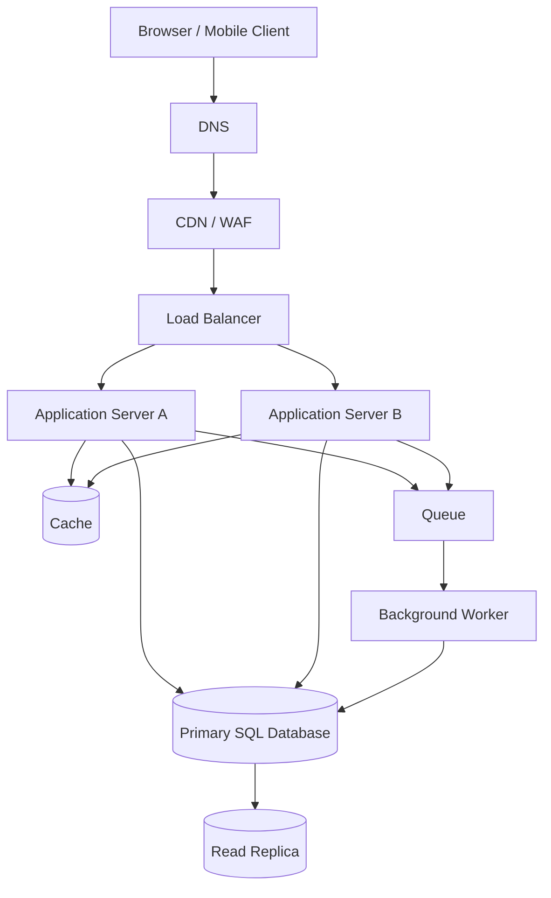

# QuickNotes System Architecture

## Functional requirements
- Users can create, list, retrieve, edit, delete, and tag notes.
- Users can only access notes they own.
- The API validates input and returns consistent JSON errors.
- Users can list notes by newest first and filter by tag.

## Non-functional requirements
- Availability target: 99.9% monthly, subject to operational validation.
- Typical read latency target: p95 below 300 ms; writes p95 below 500 ms under expected load.
- TLS in transit, encrypted storage, managed secrets, least-privilege access, and audit logging.
- Horizontal application scaling, backups, monitoring, and tested recovery procedures.
- Pagination and rate limits protect the service during spikes.

## Estimate for 1 million users

These are planning assumptions, not measured production figures:
- Assume 1,000,000 registered users, with 10% active on a typical day (100,000 daily active users).
- Assume each active user performs 20 reads and 2 writes per day.
- Daily reads = 100,000 × 20 = 2,000,000; average reads/sec = 2,000,000 / 86,400 ≈ 23.1.
- Daily writes = 100,000 × 2 = 200,000; average writes/sec = 200,000 / 86,400 ≈ 2.3.
- For a rough peak factor of 10×, plan initially for about 231 reads/sec and 23 writes/sec, then load-test and revise.
- Assume 20 notes per active user created/retained per year, with an average stored payload of 2 KB: 1,000,000 × 20 × 2 KB ≈ 40 GB/year of note payload if all users create 20 notes. Indexes, metadata, replicas, logs, backups, and growth overhead are additional. Under the daily-active assumption, if only active users create 20/year, payload is roughly 4 GB/year. Capacity planning should make the chosen activity assumption explicit.

## Architecture diagram

## What each component solves
- **Client:** provides the user interface and sends HTTPS requests without containing trusted business rules.
- **DNS:** maps the service hostname to the edge entry point and supports controlled routing.
- **CDN/WAF:** serves static assets near users and filters common malicious traffic before it reaches the app.
- **Load balancer:** distributes requests across healthy application instances and removes unhealthy instances from rotation.
- **Application servers A and B:** run API logic horizontally so one instance can fail without stopping all API traffic.
- **Cache:** reduces repeated database reads and latency for frequently accessed data; use short TTLs and invalidate on writes.
- **Primary SQL database:** provides durable, transactional writes and relational integrity.
- **Read replica:** offloads suitable read queries from the primary; replication may lag, so read-after-write requests may need the primary.
- **Queue:** buffers asynchronous work and absorbs bursts without holding user requests open.
- **Worker:** processes queued work such as notifications or exports and retries transient failures safely.

## GET /v1/notes request flow
1. The client resolves the hostname through DNS and connects over HTTPS to the CDN/WAF.
2. The edge layer applies security rules and forwards dynamic API traffic to the load balancer.
3. The load balancer selects a healthy application server.
4. The server validates the token, checks permissions, and parses pagination/filter parameters.
5. The server checks cache for a safe user-scoped key; on a miss, it queries the read replica when eventual consistency is acceptable.
6. The server returns the JSON page and pagination cursor; cacheable results may be stored briefly.

## POST /v1/notes request flow
1. The client sends a JSON request over HTTPS through the edge and load balancer.
2. The application server authenticates the user and validates title/body limits.
3. The server inserts the note into the primary database in a transaction.
4. After commit, the server invalidates relevant cache entries and/or publishes a durable event to the queue.
5. A worker handles asynchronous tasks and retries transient failures with backoff and idempotency.
6. The API returns `201 Created` with the new note; a follow-up read that requires immediate consistency is routed to the primary.

## Trade-offs and failure resilience
- **Cache speed vs freshness:** caching reduces database load but can serve stale data. Use short TTLs, user-scoped keys, and invalidation after successful writes.
- **Read replicas vs consistency:** replicas increase read capacity but replication lag is possible. Use the primary for writes and read-after-write flows.
- **Queue vs immediate simplicity:** a queue makes background tasks resilient to spikes but adds operational complexity and eventual completion. Make consumers idempotent and monitor queue age/depth.
- **Managed components vs cost/control:** managed database/cache services reduce operational burden but may cost more and create provider coupling.

## Avoiding single points of failure
Run at least two application instances across separate availability zones behind health-checked load balancing. Deploy redundant edge/DNS configuration, use a highly available managed database with automated failover and backups, configure cache/queue replication where supported, and monitor recovery objectives with regular restore and failover tests. A read replica improves read capacity but is not, by itself, a substitute for database backups or a tested failover plan.
