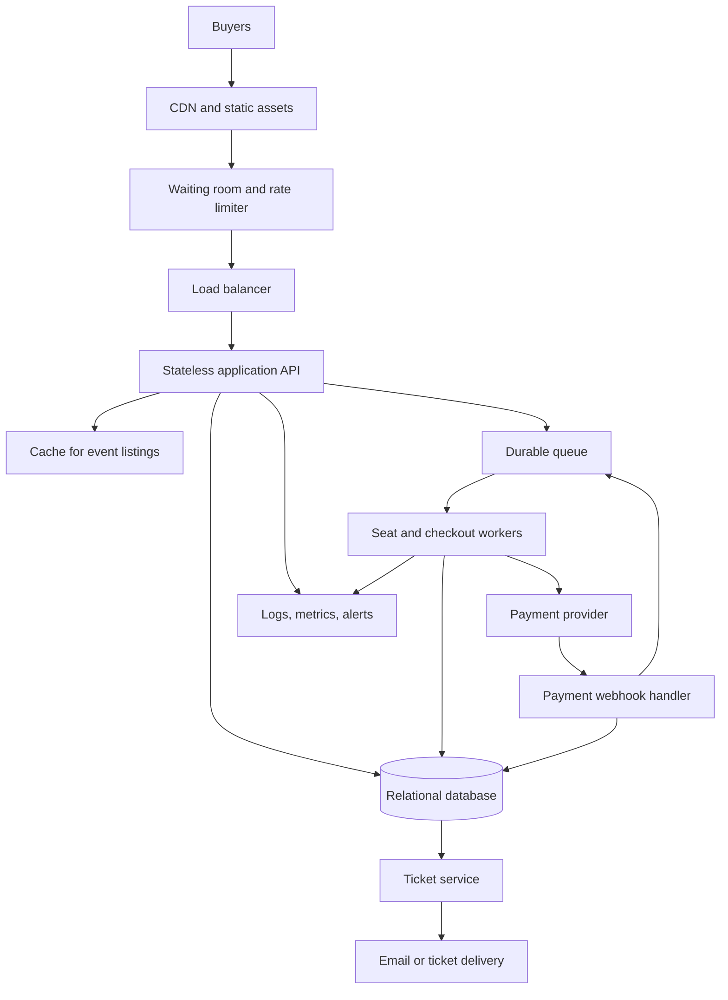

# TicketHub: Event Ticketing System Design

## 1. Requirements

### Functional requirements
- Users can register, sign in, and manage their profiles.
- Users can browse, search, and filter concerts and events.
- Users can view event details, prices, and seat availability.
- Users can temporarily hold an available seat while checking out.
- Users can pay for an order and receive confirmed tickets.
- Users can view their orders and tickets.
- Organizers can create events, configure seating, and set ticket prices.
- The system can expire unpaid seat holds and release seats.

### Non-functional requirements
- **Speed:** Event listings and event details should load quickly. Cache public event information, but do not rely on cached data to confirm whether a seat can be purchased.
- **Correctness:** A seat must not be confirmed for two different orders. Payment callbacks must be handled idempotently so a repeated callback cannot create duplicate tickets or charge an order twice.
- **Fairness:** For a high-demand sale, requests should enter a controlled queue and be processed in a predictable order. Apply rate limits and bot protection, and show users their queue status.
- **Availability:** Browsing should remain available during a sale even if checkout is under heavy load.
- **Security:** Use authenticated requests where needed, validate inputs, protect payment flows, and never store raw card details.
- **Scalability:** Add application workers and queue capacity when traffic rises.
- **Recoverability:** Keep durable order and payment records, backups, monitoring, and alerts.

## 2. Traffic estimates

### Normal day
Given:
- Registered users: 2,000,000
- Daily visitors: 50,000
- Pages per visitor: 10
- Tickets sold per day: 5,000

Page views per normal day:

`50,000 visitors × 10 pages = 500,000 page views/day`

Average page views per second across 24 hours:

`500,000 ÷ 86,400 ≈ 5.8 page views/second`

This is only a daily average. Actual traffic may be higher during busy hours. The 5,000 daily ticket sales are not the same as the number of checkout requests because a user may retry or abandon checkout.

### Popular concert sale
Given:
- 200,000 people try to buy tickets in 10 minutes
- The event has 20,000 seats

Average incoming buyer attempts:

`200,000 ÷ 600 seconds ≈ 333 attempts/second`

Demand is `200,000 ÷ 20,000 = 10` times the available seat count. Not everyone can get a ticket. The system must avoid sending every request directly to the database at once. Use a waiting room/queue, rate limits, and a controlled number of checkout workers.

### Comparison
The sale produces about 333 buyer attempts per second on average during those 10 minutes, compared with about 5.8 page views per second averaged across a normal day. These measures are different kinds of requests, so the comparison is an indication of the sudden load increase, not a direct capacity benchmark. The peak may also be much higher than the average.

## 3. API design

All endpoints use HTTPS. Authenticated endpoints require a valid session or access token. Responses should include useful error codes and request IDs.

| Method and endpoint | Purpose | Important behavior |
|---|---|---|
| `GET /api/events?query=&page=` | Browse and search events | Cache public event data; paginate results. |
| `GET /api/events/{eventId}` | View event details | Return venue, date, price range, and sale status. |
| `GET /api/events/{eventId}/seats` | View seat map and availability | Availability is informational and may change; the hold endpoint makes the authoritative check. |
| `POST /api/seat-holds` | Hold a seat | Body includes `eventId` and `seatId`; atomically reserve the seat for the user for a short period, such as 5 minutes. |
| `POST /api/orders` | Create an order from valid holds | Verify that the holds belong to the user and have not expired. Use an idempotency key. |
| `POST /api/orders/{orderId}/payment` | Start payment | Create a payment-provider session; do not store card details. |
| `POST /api/payment-webhooks` | Receive payment result | Verify provider signature and process callbacks idempotently. |
| `GET /api/me/tickets` | View the signed-in user's tickets | Return only tickets belonging to that user. |
| `GET /api/orders/{orderId}` | View order status | Check ownership and return pending, paid, expired, or failed status. |

Suggested responses include `200 OK` for successful reads, `201 Created` for a new hold/order, `409 Conflict` if a seat is no longer available, `401 Unauthorized` for a missing session, and `429 Too Many Requests` when rate-limited.

## 4. Data model

The following is a simplified relational model. Use primary keys, foreign keys, indexes, and database constraints.

### `users`
- `user_id` BIGINT primary key
- `email` VARCHAR unique, not null
- `password_hash` VARCHAR, not null
- `created_at` TIMESTAMP

### `events`
- `event_id` BIGINT primary key
- `title` VARCHAR, not null
- `venue` VARCHAR, not null
- `starts_at` TIMESTAMP, not null
- `sale_starts_at` TIMESTAMP
- `status` VARCHAR, not null

### `seats`
- `seat_id` BIGINT primary key
- `event_id` BIGINT foreign key → `events.event_id`
- `section_name` VARCHAR
- `row_label` VARCHAR
- `seat_number` VARCHAR
- `price_cents` BIGINT, not null
- `status` VARCHAR, not null (`available`, `held`, `sold`)
- `hold_user_id` BIGINT nullable foreign key → `users.user_id`
- `hold_expires_at` TIMESTAMP nullable
- Unique constraint on `(event_id, section_name, row_label, seat_number)`

### `orders`
- `order_id` BIGINT primary key
- `user_id` BIGINT foreign key → `users.user_id`
- `status` VARCHAR, not null (`pending`, `paid`, `expired`, `failed`)
- `total_cents` BIGINT, not null
- `idempotency_key` VARCHAR unique, not null
- `created_at` TIMESTAMP, not null
- `paid_at` TIMESTAMP nullable

### `order_items`
- `order_item_id` BIGINT primary key
- `order_id` BIGINT foreign key → `orders.order_id`
- `seat_id` BIGINT foreign key → `seats.seat_id`
- `price_cents` BIGINT, not null
- Unique constraint on `seat_id` so a seat cannot appear in two confirmed order items.

### `payments`
- `payment_id` BIGINT primary key
- `order_id` BIGINT foreign key → `orders.order_id`
- `provider_reference` VARCHAR unique
- `status` VARCHAR, not null
- `amount_cents` BIGINT, not null
- `created_at` TIMESTAMP, not null

### Relationships
- One user can create many orders.
- One event has many seats.
- One order has many order items.
- Each order item refers to one seat.
- An order can have payment attempts recorded in the payments table.

## 5. Preventing double-booking

The seat map is not the final authority because two users may see the same seat as available at nearly the same time. The database must decide who gets it.

1. When a user requests a hold, start a database transaction.
2. Lock the seat row with a row-level lock (for example, `SELECT ... FOR UPDATE`) or perform an atomic conditional update that succeeds only when the seat is available or its previous hold has expired.
3. Check the current hold expiry using the database's current time. If the seat is already sold or has a valid hold, reject the request with `409 Conflict`.
4. Set `status = 'held'`, `hold_user_id`, and `hold_expires_at`, then commit.
5. At checkout, verify the hold belongs to the buyer and is still valid. Create the order and order item in a transaction.
6. On successful payment, confirm the order and mark the seat sold in a transaction. The unique constraint on `order_items.seat_id` provides a final guard against two orders claiming the same seat.
7. If a hold expires or payment fails, release the seat only after verifying that the current hold still belongs to that attempt. A late payment callback must not silently steal a seat that has since been sold to someone else; send such cases to a defined refund/manual-review flow.

Keep transactions short. Never hold a database transaction open while waiting for an external payment provider. Use idempotency keys for order creation and payment webhooks so retries do not create duplicate results.

## 6. Architecture

### Component explanation
- **CDN:** Serves static files such as images, stylesheets, and scripts close to users.
- **Waiting room and rate limiter:** Smooths the sale spike, limits abusive traffic, and controls how many buyers enter checkout at once.
- **Load balancer:** Distributes requests across healthy application instances.
- **Stateless application API:** Handles event browsing, authentication, seat-hold requests, orders, and ticket queries. Multiple instances can be added horizontally.
- **Cache:** Speeds up event pages and other read-heavy public information. It is not the source of truth for seat ownership.
- **Durable queue and workers:** Process controlled checkout tasks, payment events, and ticket delivery. Retries must be safe and idempotent.
- **Relational database:** Stores authoritative seat status, holds, orders, payments, and constraints. Use backups and monitor connection and lock pressure.
- **Payment provider and webhook handler:** Process payments outside the database transaction, verify signed callbacks, and safely handle retries.
- **Ticket service and delivery:** Issues tickets only after payment and order confirmation; delivery can be asynchronous.
- **Logs, metrics, and alerts:** Track latency, queue depth, failed payments, database locks, errors, and seat-hold conflicts.

During the popular sale, event pages can be served from cache, while the waiting room limits concurrent checkout traffic. Workers process seat holds in a controlled way, and the database transaction and constraints remain responsible for correctness.

## 7. Trade-offs

### Trade-off 1: Fair queue versus instant access
A waiting room adds friction and may make users wait, but it prevents the 200,000 buyer attempts from overwhelming the application and database. Queue policy must be transparent and consistent to support fairness.

### Trade-off 2: Strong consistency versus maximum throughput
Seat allocation needs strong transactional consistency, which can reduce throughput when many users compete for the same seats. It is safer to reject or queue some requests than to allow double-booking. Caching is used for browsing, not for final seat allocation.

### Trade-off 3: Short holds versus abandoned checkout
Short holds help release inventory quickly when users abandon checkout, but they give buyers less time to complete payment. A clear countdown and a carefully designed expiry process balance convenience with availability.

## Operational notes
- Monitor API latency, queue wait time, database lock waits, payment failures, and the number of held seats.
- Test the sale with load tests and concurrent requests before launch.
- Keep payment credentials and secrets outside source control.
- Use backups and test restoration, not just backup creation.
